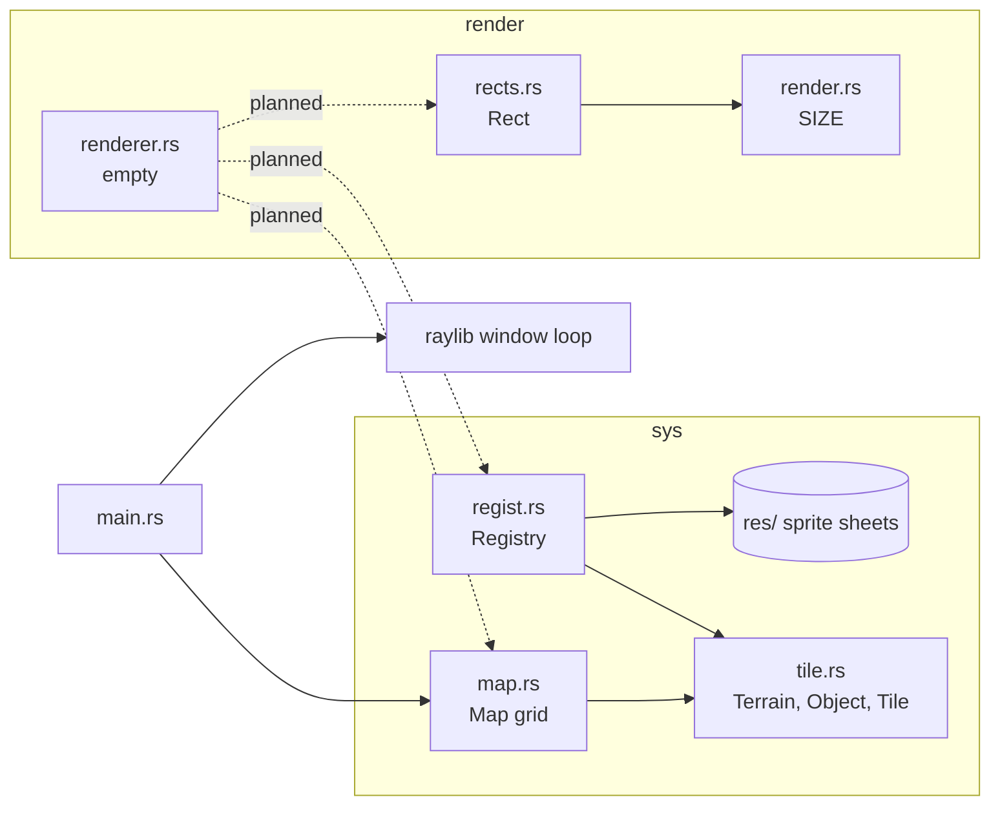
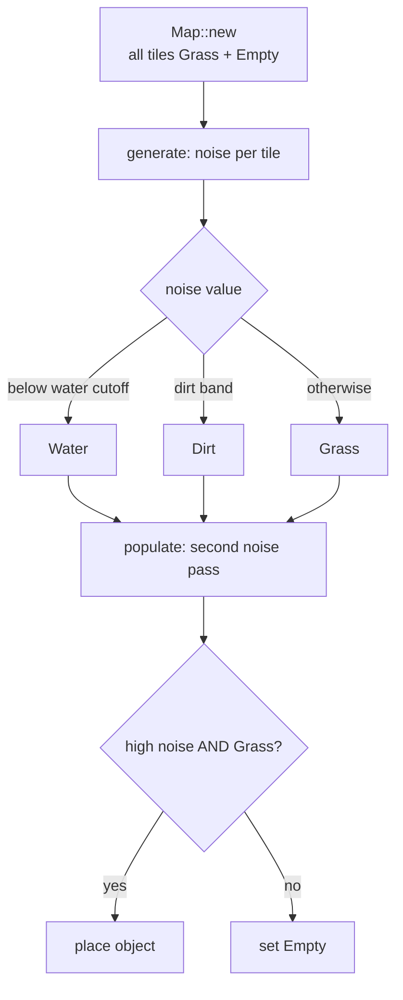

# AGENTS.md

This file sets the rules for any AI agent (Claude or otherwise) working in this repository, and gives a plain-English map of the project so the agent can guide well.

---

## 1. Collaboration Rules: The Guide and the Hands

```
   ┌──────────────────────┐                    ┌──────────────────────┐
   │      THE GUIDE       │   explanations,    │      THE HANDS       │
   │      (the agent)     │ ─────────────────► │      (the user)      │
   │                      │   diagnoses,       │                      │
   │ • reads the code     │   step-by-step     │ • writes the code    │
   │ • finds problems     │   directions       │ • runs the build     │
   │ • explains the fix   │                    │ • makes every change │
   │ • edits docs only    │ ◄───────────────── │ • decides what ships │
   └──────────────────────┘   questions,       └──────────────────────┘
                              errors, results
```

### 1.1 What the agent may and may not do

| Action | Allowed? | Notes |
|---|---|---|
| Read any file in the repo | ✅ Yes | Read freely to understand the problem. |
| Run read-only commands (`cargo check`, `cargo build`, `cargo clippy`, `git status`, `git diff`, `git log`) | ✅ Yes | To see errors and warnings. Never pass flags that rewrite files (e.g. `cargo fix`, `cargo fmt`, `clippy --fix`). |
| Edit documentation (`*.md` files, a `docs/` folder) | ✅ Yes | This is the only thing the agent writes. |
| Create, edit, rename, or delete anything in `src/` | ❌ **Never** | Source is immutable to the agent. |
| Edit `Cargo.toml` or `Cargo.lock` | ❌ **Never** | Tell the user which dependency to add or change and why. |
| Add, remove, or alter anything in `res/` | ❌ **Never** | Assets belong to the user. |
| Write code snippets in replies or docs | ❌ **Never** | Not even "just one line". See 1.2. |
| Commit or push | ❌ Only if the user explicitly asks, and only for documentation changes. |

If the user asks the agent to "just write it", the agent should politely restate the arrangement and offer the most detailed plain-English directions it can instead.

### 1.2 How to describe a fix without code

Every fix must be explained in plain English. A good fix description answers these five questions, ideally in a table:

| Question | Example of a good answer |
|---|---|
| **Where?** | "In `src/sys/map.rs`, inside the `generate` function, in the first pass over the grid." |
| **What is wrong?** | "The second threshold check can never be true, because any value below negative one is already below negative zero point two, so the first check catches it first." |
| **What should change?** | "Make the dirt check use a number that sits *between* the water cutoff and the grass range, for example a little above the water cutoff." |
| **Why?** | "Right now no tile can ever become dirt, so the map has only water and grass." |
| **How to confirm?** | "Build and run. You should see a band of dirt along the edges of lakes." |

Allowed ways to be precise without writing code:

- Name files, functions, structs, enums, fields, and variants by their exact names (in backticks).
- Name standard-library or crate items to look up (e.g. "look at the `Default` trait", "read the raylib docs for loading a texture").
- Describe logic in words or numbered steps ("first check X; if it is true, do Y; otherwise do Z").
- Quote compiler error messages verbatim, since those are output, not code to copy.

Not allowed: code blocks of Rust, pseudo-code that is really just Rust with the types removed, or full function bodies "for reference".

### 1.3 Making it clear

- **Plain English first.** Assume the reader is learning. Define jargon the first time it appears (e.g. "borrow: temporarily lending a value to a function without giving it away").
- **Use tables** to compare options, list steps, or summarise causes and effects.
- **Use diagrams** to show how parts of the program connect or how data flows.
  - In terminal replies, use plain-text (ASCII) diagrams, because diagram markup does not render in a terminal.
  - In documentation files, Mermaid diagrams are fine since they render on GitHub.
- **One step at a time.** For larger changes, give a numbered plan and let the Hands work through it, checking back after each step.
- **Explain the "why".** The goal is for the Hands to understand the change well enough to have written it themselves.

### 1.4 The working loop

```
  Hands describe goal or problem
            │
            ▼
  Guide reads code / runs cargo check ──► Guide explains cause (plain English + table/diagram)
                                                     │
                                                     ▼
                                    Guide gives step-by-step directions
                                                     │
                                                     ▼
                                    Hands make the change and build
                                                     │
                          ┌──────────────────────────┴──────────────┐
                          ▼                                         ▼
                   Works as expected                     Error or surprise
                          │                                         │
                          ▼                                         ▼
               Guide updates docs if useful          Hands share output → loop back
```

---

## 2. Project Overview

**colony-game** is a tile-based colony simulation written in Rust (edition 2024), drawn with **raylib**. The world is a grid of tiles generated from noise.

### 2.1 Dependencies

| Crate | Version | What it is used for |
|---|---|---|
| `raylib` | 6.0.0 | Opens the window, draws to the screen, loads textures. |
| `noise` | 0.9.0 | OpenSimplex noise for generating terrain and placing objects. |
| `rand` | 0.10.3 | Random numbers (imported, not yet used). |

### 2.2 File map

```
colony-game/
├── Cargo.toml              project manifest and dependencies
├── res/                    art assets (sprite sheets)
│   ├── terrain/terrain_tiles24.png
│   └── objects/trees/{summer,autumn}_pine_tree_tiles.png
└── src/
    ├── main.rs             entry point: creates the map and the window, runs the frame loop
    ├── render.rs           render module root: tile SIZE constant, res_dir()
    │   ├── rects.rs        Rect: converts sheet grid positions into pixel rectangles
    │   └── renderer.rs     (empty, intended for drawing code)
    └── sys.rs              systems module root: res_dir()
        ├── tile.rs         WHO/WHAT  – Terrain and Object enums, Tile struct
        ├── map.rs          WHERE     – Map grid, generate() and populate()
        ├── regist.rs       WHY/HOW   – Registry: names, walkability, sprite coordinates
        └── colonist.rs     (empty, intended for colonists)
```

### 2.3 How the pieces relate



### 2.4 Core data

| Type | Kind | Holds |
|---|---|---|
| `Terrain` | enum | `Grass`, `Dirt`, `Water` |
| `Object` | enum | `Empty`, `Tree`, `Forest`, `Clump`, `Wall` |
| `Tile` | struct | one `Terrain` and one `Object`; defaults to Grass + Empty |
| `Map` | struct | width, height, and a flat list of tiles stored row by row |
| `Registry` | struct | lookup tables from each `Terrain`/`Object` to its name, walkability, and sprite location |
| `SheetCoords` | struct | where a sprite sits on a sprite sheet (column, row, width, height, which sheet) |
| `Rect` / `RectType` | struct / enum | a sheet position that can be turned into a raylib rectangle; terrain cells are `SIZE` pixels, object cells are half that |

### 2.5 World generation flow



---

## 3. Current State and Known Issues

Observed in the code as of the initial commit. These are for the Guide to explain and the Hands to fix; the Guide should update this table as items are resolved.

| # | Where | Issue (plain English) | Effect |
|---|---|---|---|
| 1 | `sys/map.rs`, `generate` | The dirt threshold is lower than the water threshold, so it can never be reached. | No dirt ever appears. |
| 2 | `sys/map.rs`, `populate` | Tiles that fail the placement test are reset to Empty, wiping any object placed by an earlier call. | Calling `populate` twice for different objects keeps only the last kind. |
| 3 | `sys/regist.rs` | Registry has entries only for `Empty` and `Tree`, but `Object` also has `Forest`, `Clump`, `Wall`. | Looking up those three will panic at runtime. |
| 4 | `render/rects.rs`, `Rect::new` | The constructor takes `self`, so you need an existing `Rect` to make a new one. | Cannot actually create a first `Rect`. |
| 5 | `sys.rs` and `render.rs` | `res_dir` is written twice, identically. | Duplicate code to keep in sync. |
| 6 | `sys.rs` | `colonist.rs` exists but is not declared as a module. | The compiler ignores the file. |
| 7 | `render.rs` vs `res/terrain` | `SIZE` is 32 but the terrain sheet name suggests 24-pixel tiles. | Sprites may be cut from the wrong places. Verify against the image. |
| 8 | `main.rs` | The map is created but never generated or drawn; window title is still "Hello Raylib"; several imports are unused. | The game shows only placeholder text. |
| 9 | `sys/regist.rs` | `Registry::new` builds paths for the sheets but never loads textures; `SheetCoords` fields are private. | Nothing outside the module can read sprite positions yet. |

---

## 4. Documentation the Guide Maintains

| File | Purpose |
|---|---|
| `CLAUDE.md` | Short pointer to this file. |
| `AGENTS.md` | Rules, project map, known issues (this file). |
| `docs/` *(optional)* | Longer explainers or step-by-step guides the Hands ask for. |

When the code changes, the Guide should refresh sections 2 and 3 so they stay accurate.
